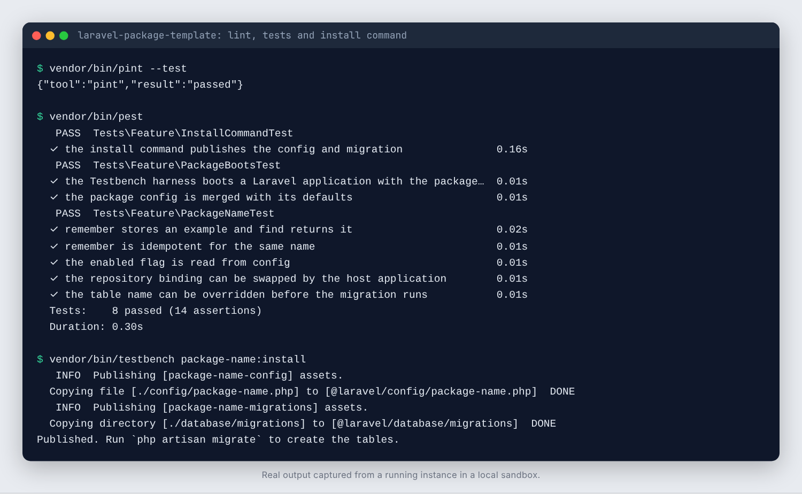

# vendor-name/package-name

A starter template for a Laravel package: service provider, publishable config
and migration, a facade, an Artisan command, and a test and CI setup that runs
against every supported PHP and Laravel combination.

Click **Use this template** on GitHub, clone, then run:

```bash
./rename.sh acme/awesome-tools   # <vendor>/<package>, kebab-case
composer install
composer lint:fix                 # the new namespace changes import order
composer check                    # pint + phpstan + pest
```

`rename.sh` swaps the placeholder tokens (`vendor-name`, `package-name`,
`VendorName`, `PackageName`, `package_name`, `PACKAGE_NAME`) in file contents
and file names, then deletes itself.

## Screenshots



_Real output from a local run of Pint, Pest and the install command through Testbench (PHP 8.3). Static analysis is not shown: Larastan could not be installed in this sandbox, so CI is the check for that step._

## What is included

| Path | Purpose |
| --- | --- |
| `composer.json` | Library manifest. Depends on individual `illuminate/*` components (`^12.0\|^13.0`), not `laravel/framework`. |
| `src/PackageNameServiceProvider.php` | Merges config, binds the repository, publishes config and migrations, registers commands. |
| `src/PackageName.php`, `src/Facades/PackageName.php` | Public entry point and facade. Replace the example behaviour. |
| `src/Contracts/ExampleRepository.php`, `src/EloquentExampleRepository.php` | Contract plus default implementation; host apps can rebind the contract. |
| `src/Models/Example.php` | Example model whose table name comes from config. |
| `src/Console/InstallCommand.php` | `package-name:install` publishes the config and migrations. |
| `config/package-name.php` | Publishable config with env-backed defaults. |
| `database/migrations/` | Publishable migration (published through `publishesMigrations`). |
| `tests/` | Pest on Orchestra Testbench. **SQLite in memory by default**, so no services are needed. |
| `phpunit.xml.dist`, `pint.json`, `phpstan.neon` | Test, style (Laravel preset, strict types) and Larastan level 8 config. |
| `.gitattributes` | `export-ignore` keeps tests, CI and tooling out of `composer require` archives. |
| `.gitignore` | Ignores `composer.lock`: a library lets consumers resolve their own versions. |
| `.github/workflows/ci.yml` | Secret scan (gitleaks), Pint, Larastan, a PHP x Laravel test matrix, `composer audit` and osv-scanner. |
| `.github/workflows/codeql.yml` | CodeQL for the workflow files. CodeQL does not support PHP. |
| `.github/dependabot.yml` | Weekly Composer and GitHub Actions updates. |
| `UPGRADE.md`, `CHANGELOG.md` | Upgrade guide and changelog structure. |
| `docs/project-memory/` | Empty documentation scaffold; `scaffold-memory-pack.sh` recreates missing files. |
| `osv-scanner.toml`, `.gitleaksignore` | Empty scanner configs. Exceptions must be dated and justified. |

## Commands

```bash
composer test        # Pest
composer lint        # Pint, check only
composer lint:fix    # Pint, rewrite files
composer analyse     # Larastan (PHPStan level 8)
composer check       # all three
```

## Supported versions

| PHP | Laravel | Testbench |
| --- | --- | --- |
| 8.2, 8.3 | 12.x | 10.x |
| 8.3, 8.4, 8.5 | 13.x | 11.x |

Keep `composer.json`, the matrix in `.github/workflows/ci.yml`, and
`UPGRADE.md` in step when you add or drop a version.

## Testing against another database

`tests/TestCase.php` configures SQLite in memory. If your package needs a
specific database, override the connection in `getEnvironmentSetUp()` and add
a `services:` block to the `test` job in `ci.yml`.

## Before the first release

1. Edit the author block in `composer.json` and the copyright line in `LICENSE`
   (the template ships an MIT placeholder).
2. Replace the example behaviour in `src/`, keep the tests green.
3. Tag `v0.1.0` and submit the package to Packagist.
4. Turn on branch protection for `main` and require the CI jobs.
